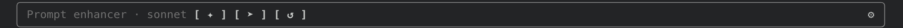
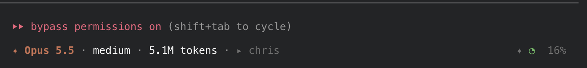

# claude-stuff

My Claude Code add-ons, kept in one place. Each one installs from this repository with one line.

| Kind | Status |
| --- | --- |
| [Mods](#mods) | Available |
| [Plugins](#plugins) | Coming soon |
| [Skills](#skills) | Coming soon |
| [Agents and hooks](#agents-and-hooks) | Coming soon |

## Mods

A mod changes how Claude Code looks or behaves, for example a bar under the prompt box. Mods need a Claude Code version that supports them. They draw in the terminal and the desktop app. They do not draw in the VS Code extension.

### prompt-enhancer

A bar under the prompt box that improves your draft before you send it. It never sends anything on its own.



- **Show or hide:** the bar stays hidden until you click the ✦ icon next to the context pie (installed with the chat-status mod), or type `/enhancer`.
- **✦ Enhance:** rewrites your draft using your CLAUDE.md files, the start of the README, package.json, git state, recent chat messages and the skills that match your words. The new version lands in the prompt box. You read it, then press Enter or ➤.
- **Questions:** if the draft has gaps, it asks up to three pick-one questions first. Your answers go into the rewrite as decisions already made. You can skip them.
- **↶ Undo:** puts your original draft back.
- **➤ Send:** sends what is in the box.
- **↺ Reset:** clears the questions, answers and status. The bar also resets by itself when you send a prompt.
- **⚙ Gear:** opens settings. Pick the model (follow your session, Haiku, Sonnet or Opus), and turn questions or project files on or off. Choices are saved between sessions.
- **Theme:** the outline and text use your Claude Code theme colors, so it fits light and dark mode.

**Cost and privacy.** Each Enhance makes one extra model call, and one more when it asks questions. By default it sends your draft, project files and recent chat messages to the model you picked. Turn off "Send project files" in the gear to stop sending project files.

**Install**

At the prompt of a terminal session:

```text
/plugin install prompt-enhancer --marketplace advenimus/claude-stuff
```

From a shell:

```sh
claude plugin install prompt-enhancer --marketplace advenimus/claude-stuff
```

In the desktop app, `/plugin` does not run. Click + next to the prompt box, then Plugins, then Add marketplace with `advenimus/claude-stuff`, then Add plugin.

A mod is code that runs with your permissions and can see your prompts. Read the source in [mods/prompt-enhancer](mods/prompt-enhancer) before you install it.

### chat-status

A status line under the prompt box for the chat you have on screen: the model, effort and tokens of the main chat, or of the subagent you are viewing, plus the folder and a pie with the context percentage on the right. It was called context-pie before 0.2.0.



- **Model:** click it to pick Opus, Sonnet or Haiku. It runs `/model` for you.
- **Subagents:** open a subagent from the tasks list and the line switches to it: `↳ name`, its model, its effort and its tokens. Go back and it shows the main chat again.
- **Effort:** click it to pick low, medium, high, xhigh or max. It runs `/effort` for you. It shows after the first message.
- **Locked while busy:** the model and effort pickers do nothing while Claude or a subagent is working, or while you view a subagent. They look the same but ignore clicks. They work again once the work is done.
- **Tokens:** in the main chat, the session total across the main chat and its subagents, as `/usage` counts input, output and cache. In a subagent, that agent's own. It updates after each model reply. Click it to switch between tokens and the session cost in US dollars.
- **Pie:** the main chat's context. Goes from empty to full as it fills. Green below 60%, yellow from 60%, red from 80%.
- **✦ icon:** appears when the prompt-enhancer mod is installed. Click it to show or hide that bar. Once you type in the prompt it reads `✦ enhance prompt`. It does nothing while Claude or a subagent is working.
- **Theme:** uses your Claude Code theme colors, so it fits light and dark mode.
- **Privacy:** reads figures from your own session only. It sends nothing anywhere.

If you had context-pie installed, remove it first: `/plugin uninstall context-pie`.

**Install**

```text
/plugin install chat-status --marketplace advenimus/claude-stuff
```

From a shell:

```sh
claude plugin install chat-status --marketplace advenimus/claude-stuff
```

Read the source in [mods/chat-status](mods/chat-status) before you install it.

## Plugins

Coming soon.

## Skills

Coming soon.

## Agents and hooks

Coming soon.
